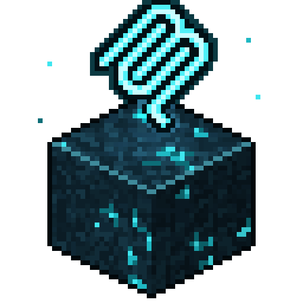

<p align="center">
  
</p>

<h1 align="center">Sculkwire</h1>

<p align="center">An MCP server that lets coding agents build, validate, test and play Minecraft Bedrock add-ons.</p>

<p align="center">
  <a href="docs/tools.md">Tools</a> ·
  <a href="#quick-start">Quick Start</a> ·
  <a href="docs/client.md">Game Client Setup</a> ·
  <a href="docs/extensions.md">Extensions</a> ·
  <a href="#cli">CLI</a>
</p>

## MCP Tools

| Category | Tools |
|---|---|
| Knowledge | `docs_search`, `api_lookup`, `component_lookup`, `command_lookup`, `molang_lookup`, `vanilla_example`, `changelog_search`, `knowledge_versions` |
| Validation | `validate_pack`, `validate_file` |
| Server | `bds_check`, `gametest_run`, `bds_session_start`, `bds_session_command`, `bds_session_logs`, `bds_session_stop`, `script_profile` |
| Game | `game_launch`, `game_status`, `game_command`, `game_reload`, `game_log`, `game_screenshot`, `game_query`, `game_registry`, `game_input`, `game_input_lock`, `game_ui`, `game_settings`, `world_settings`, `game_stop` |
| Player | `player_act`, `player_job`, `player_state`, `player_inventory` |
| Containers and Crafting | `container`, `craft`, `interact`, `screen` |
| Engine | `engine_attach`, `engine_status`, `engine_command`, `engine_player`, `engine_tick`, `engine_screenshot` |
| Game Files | `game_builds`, `game_vanilla_packs`, `game_extract_pack` |
| Decision Model | `decision_status` |

See the [tool reference](docs/tools.md) for what each tool does and its inputs.

## Features

- **Versioned knowledge.** Docs, Script API, components, commands, Molang, vanilla examples and changelogs, for both stable and preview. Every answer states the game version it describes.
- **Validation.** Every problem is reported with a file, line, column and rule code. Regolith projects are built with rgl first.
- **Bedrock Dedicated Server.** Load checks, headless GameTest runs and script profiling. Regolith projects are built with rgl first.
- **Live game bridge.** Launch the real client in a private test world with your packs, reload after edits, read the content log, query the world, take screenshots and send keyboard and mouse input, on Windows and Linux. On Linux the input stays inside gamescope, so your own mouse and keyboard stay yours, and the game can also run off-screen. On Windows the agent uses the system keyboard and mouse while the game window is in the foreground, and stops when you switch away. A sign-in error at launch is recovered without restarting the game.
- **Player control.** The agent plays like a person through `player_act`, on Linux and Windows. That covers smooth camera movement, pathfinding over blocks, ladders, water and gaps, and combat against zombies, skeletons, spiders and creepers. `play` runs a goal in the background, with an optional decision model as an advisor. On Windows a running action stops and a `play` job pauses while the game window is not in the foreground.
- **Game files.** Reads your installed PC copy of the game: its version, and the per-version `vanilla_1.x` packs a world's `base_game_version` pins, unpacked from `.brarchive` into plain folders you can grep or diff against.
- **In-game agent.** Loads a small DLL into the running retail game through engine hooks, on Linux under the install's Wine or Proton and natively on Windows. From inside the game it runs commands as the player, controls game time, reads the player and the level, takes screenshots through the game's own code, drives menus and screens in the background, reads inventories and containers, crafts, uses blocks and villagers like a right click, runs every station's own action, keeps your keyboard and mouse out while the agent plays (F9 takes over), and reads or changes game and world settings. `player_act`, `game_input` and the sign-in recovery use it when it is attached. The DLL is the prebuilt one from the GitHub release, or built from `native/` with cargo. See [In-Game Agent](docs/engine.md).
- **Extensions.** Packages in your sculkwire config folder can add MCP tools, CLI commands and an in-process input route. See [Extensions](docs/extensions.md).
- **Benchmarks.** `sculk bench` builds arenas in a test world and measures combat and movement skills.

## Quick Start

sculkwire needs Node.js 22.18 or newer and git. Both install paths below put a `sculk` command on your PATH and register a stable launcher with your MCP client, so later updates never change the client configuration. [Install and Update](docs/install.md) has the details.

### Install With Your Agent

Paste this into your AI agent harness:

```text
Install the sculkwire MCP server: clone https://github.com/ve3dy/sculkwire.git and follow the "Agent Install" steps in its docs/install.md.
```

The agent checks Node.js and git, runs the installer, registers sculkwire with itself and runs `sculk doctor`. It asks one optional question about a decision model (default None).

### Install With a Script

Linux and macOS:

```sh
git clone https://github.com/ve3dy/sculkwire.git
cd sculkwire
./install.sh
```

Windows (Windows PowerShell 5.1 or PowerShell 7):

```powershell
git clone https://github.com/ve3dy/sculkwire.git
cd sculkwire
.\install.ps1
```

The installer checks Node.js and git, installs the newest release into your data folder, puts `sculk` on your PATH (it says what it changes first; `--no-path` / `-NoPath` skips it) and runs `sculk setup`. It asks two questions. The first is the optional decision model, where pressing Enter keeps None (the default). The second is which MCP clients to register with. `--yes` skips both questions, and `--decision none|openrouter|zenmux|local` and `--register <clients>` answer them from the command line (`-Yes`, `-Decision` and `-Register` in PowerShell). API keys are never passed as flags. Set `OPENROUTER_API_KEY` or `ZENMUX_API_KEY` in your environment, or run `sculk setup` in a terminal to save one.

Or install in one line. Piped, the installers read their options from `SCULKWIRE_*` environment variables, see [Installers](docs/install.md#installers).

```sh
curl -fsSL https://raw.githubusercontent.com/ve3dy/sculkwire/main/install.sh | sh
```

```powershell
irm https://raw.githubusercontent.com/ve3dy/sculkwire/main/install.ps1 | iex
```

`sculk doctor` checks the game install, BDS, rgl, uv, the decision model and the installed version, one line per problem with a fix for your OS.

### Manual Setup

To run from a git checkout instead (development checkouts never update themselves), run `npm install` in the clone and add sculkwire to your MCP client configuration by hand:

```json
{
  "mcpServers": {
    "sculkwire": {
      "type": "stdio",
      "command": "node",
      "args": ["/path/to/sculkwire/src/cli.ts", "mcp"]
    }
  }
}
```

The first knowledge request downloads docs, typings and vanilla samples, which takes about a minute. Run `sculk knowledge update` (`node src/cli.ts knowledge update` in a checkout) to do this ahead of time.

## Updating

An installed sculkwire updates itself. When the MCP server starts, it checks for a new release at most once a day in the background. A new release is downloaded, installed and tested, then used by the next session. The running session keeps its version and sends a notice that a restart picks up the update. A failed check (offline, no access to the repository) changes nothing.

```sh
sculk update --check            # Show whether a newer release exists
sculk update                    # Install the newest release now
sculk update --rollback         # Switch back to the version before the last update
sculk update --channel off      # No automatic updates (release and main are the other channels)
```

The `sculkwire_version` tool and `sculk doctor` report the running version and any update waiting for the next session. In a development checkout, `sculk update` prints the `git pull` command instead.

Data sources update on their own as well. Vanilla samples, Script API typings, docs, changelogs, Bedrock Dedicated Server and rockide/schemas are each checked at most once a day, and a new upstream release is used without a sculkwire release or `sculk knowledge update`. The MCP server downloads new builds in the background; a CLI command only refreshes the version pins and leaves the downloads to the next MCP session or `sculk knowledge update`. Offline, the last copy keeps working. `sculk knowledge status` shows per source the version in use, the newest upstream and the last check.

## Optional Decision Model

The `play` action of `player_act` picks its tactics with built-in scores and works without a decision model. When one is configured (Jev through OpenRouter or ZenMux, or Kev on your own GPU), `play` asks it as an advisor at game speed, and `game_launch` can ask it to find a button when its sign-in recovery is stuck. Nothing else uses one, and the default is none. See [Decision Model](docs/decision.md) for setup, Kev and the config file.

## Requirements

| Feature | Requirement |
|---|---|
| Knowledge and validation | Node.js 22.18 or newer. rgl for Regolith projects |
| Bedrock Dedicated Server | Windows or Linux x64, and acceptance of the [Minecraft EULA](https://www.minecraft.net/eula) |
| Game client | Minecraft Bedrock for PC on Windows or Linux. On Linux, gamescope and xdotool for window and headless modes. On Windows nothing extra (Windows PowerShell 5.1 ships with Windows); input needs the game window in the foreground. See [Game Client Setup](docs/client.md) |
| In-game agent (optional) | The game running, from an install sculkwire detects; on Linux its Wine or Proton prefix is used. Without `cargo` sculkwire downloads the release build; building from `native/` needs rustup with the `x86_64-pc-windows-msvc` target, and no Windows SDK. See [In-Game Agent](docs/engine.md) |
| Game files | An installed PC (GDK) copy of Minecraft Bedrock: the Xbox app install on Windows, mcbe-gdk-linux or any Wine/Proton launcher (BedrockOnLinux, Flarial, Bottles, Lutris, Steam) on Linux, or a folder in `SCULKWIRE_GAME_DIRS` |
| Decision model (optional) | An OpenRouter or ZenMux key, or a local Kev server |

## CLI

All features are also available from the command line.

```sh
node src/cli.ts validate path/to/addon            # Exit code 1 when errors are found
node src/cli.ts bds gametest path/to/addon        # Run GameTests
node src/cli.ts game check path/to/addon --screenshot shot.png
node src/cli.ts api Entity.applyDamage
node src/cli.ts bench combat --runs 3             # Measure the player skills
node src/cli.ts doctor                            # Check the machine
node src/cli.ts --help                            # List all commands
```

With the game running, the in-game agent has its own commands. Each prints JSON on stdout.

```sh
sculk engine attach                               # Build or download the DLL, inject it, print its status
sculk engine status|command|tick|screenshot|player
sculk game lock [on|off|auto]                     # Input lock; F9 in the game takes over
sculk game settings [list|get <id>|set <id> <value>]
sculk world settings [get|set ...]
sculk game ui [screen|controls|press|key|text|click|scroll]
sculk player inventory
sculk container get <x> <y> <z>
sculk craft match|run
sculk interact block <x> <y> <z> | interact entity <id>
sculk screen state|move|act|close
```

## Data Sources

- Vanilla samples, `@minecraft/*` typings, Microsoft Learn docs, changelogs and Bedrock Dedicated Server are downloaded into your local cache and update on their own.
- [rockide/schemas](https://github.com/rockide/schemas) by the Rockide project provides the JSON schemas used first by the validator and by `component_lookup`.
- Packs unpacked from your installed copy of the game stay in your local cache.
- The icon is a pixel-art sculk block with a glowing pixel [Model Context Protocol](https://github.com/modelcontextprotocol/modelcontextprotocol) mark above it.

## License

MIT, see [LICENSE](LICENSE).

NOT AN OFFICIAL MINECRAFT PRODUCT. NOT APPROVED BY OR ASSOCIATED WITH MOJANG OR MICROSOFT.
